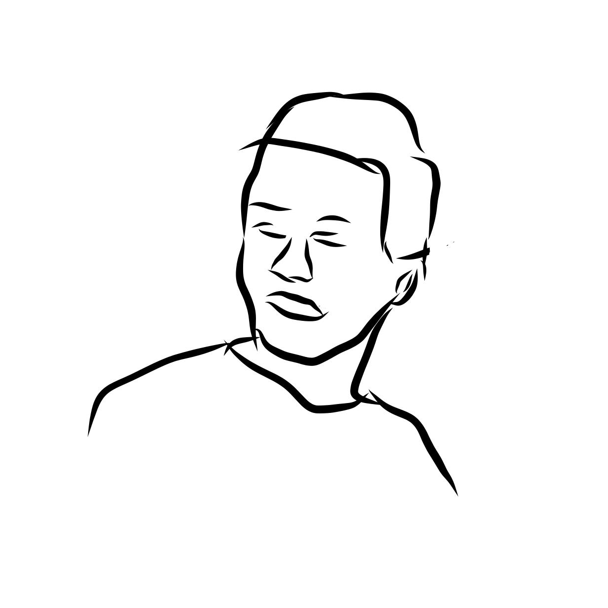

<h3>
  <samp>
    > Hey!, I am
    <b><a target="_blank" href="https://portfolio.by-mika.dev/">mika.dev</a></b>
  </samp>
</h3>

<h3>
    <samp>
      > I am an experienced developer who loves coding. Since 2015, I have acquired experience in numerous programming languages, concepts, and tools. In my free time, I enjoy bouldering.
    </samp>
</h3>

<h3>
    <samp>
      > You want to see some of my projects? 
      &nbsp;- Biggest Project Yet: <b><a href="https://starlight.by-mika.dev/">Starlight PDF</a></b> 
      &nbsp;- Most Popular: <b><a href="https://github.com/Developer-Mike/obsidian-advanced-canvas">Advanced Canvas</a></b> 
      &nbsp;- First Big Project: <b><a href="https://github.com/Developer-Mike/fn-track">FN Track</a></b> 
      &nbsp;- A Transpiler: <b><a href="https://github.com/Developer-Mike/sprout">Sprout</a></b> 
      &nbsp;- <b><a href="https://portfolio.by-mika.dev/">see more...</a></b>
    </samp>
</h3>

---

<h3>
    <samp>
      > If you like visualized data, you'll enjoy my <b><a href="https://github.com/Developer-Mike/portfolio-stats">portfolio-stats repo</a></b>.
    </samp>
</h3>

